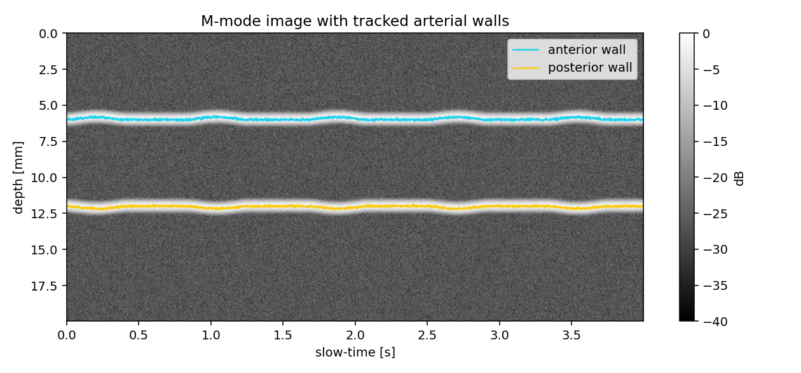
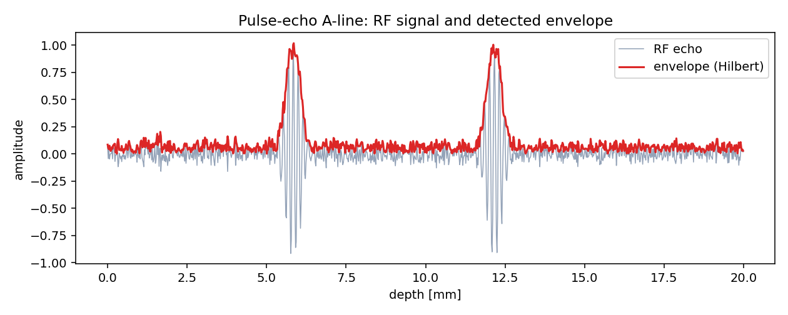
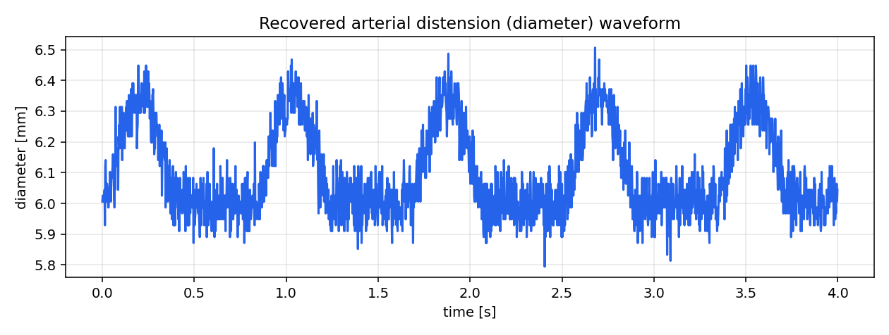

# Ultrasound Echoes to Artery-Wall Motion

> **An experimental simulation.** I built it to practice the processing behind my wearable
> ultrasound blood-pressure work: turning raw echoes into an image over time, tracking the
> artery walls, and reading how the artery widens with each heartbeat.



## What it does

A wearable ultrasound patch sends short sound pulses into the neck and listens to the echoes
coming back from the front and back walls of the carotid artery. As the heart beats, the artery
widens and narrows, and the echoes move with it. Following that motion is the first step toward
estimating blood pressure without a cuff.

Raw radio-frequency (RF) ultrasound data from a real artery is not publicly available, so this
project simulates it and then runs the real processing chain on the simulated echoes.

## How it works

1. **Simulate the echoes.** Each frame is a pulse-echo line (an "A-line") with reflections
   from two walls whose depths move at the heart rate.
2. **Envelope detection.** The Hilbert transform turns the fast RF oscillation into a smooth
   envelope, which is then log-compressed.

   

3. **M-mode image.** Stacking envelopes over time gives a depth-versus-time image, the same
   view a clinical scanner shows in M-mode.
4. **Wall tracking.** The two strongest envelope peaks in each line are the two walls.
5. **Distension.** The distance between the walls over time is the diameter waveform.

   

## Repository structure

```
ultrasound-mmode-wall-tracking/
├── mmode_wall_tracking.m   # main MATLAB implementation
├── make_figures.py         # Python port that renders the figures
├── figures/
└── requirements.txt
```

## Run it

MATLAB (Signal Processing Toolbox):

```matlab
mmode_wall_tracking
```

Python:

```bash
pip install -r requirements.txt
python make_figures.py
```

## Limits

Everything here is simulated. Real tissue adds speckle, attenuation, other reflectors and probe
motion, which this model leaves out on purpose.

---

**Author:** Yaşar Aykut Altuntop · MSc student, Biomedical Sciences and Engineering, Koç University  
[LinkedIn](https://linkedin.com/in/aykutaltuntop) · [GitHub](https://github.com/Aykut0)
